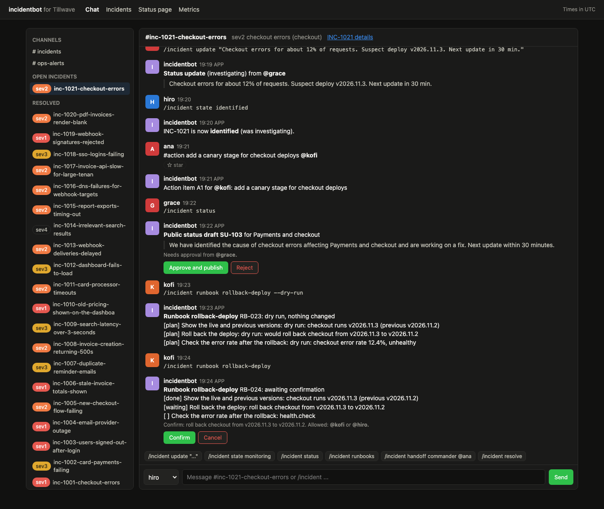

# incident-bot



An incident response bot and coordination service for Tillwave, a made-up invoicing and payments SaaS. It is the ChatOps layer that turns a page into a well-run incident: `/incident declare sev2 "checkout errors"` opens a channel, assigns an incident commander, communications lead, and ops lead, pages people according to severity policy, and nags the channel when status updates are overdue. Every command, role change, state change, starred message, deploy, and alert lands on one timeline with a timestamp. Runbooks written in YAML roll back deploys, scale services, flush caches, and flip feature flags from chat, behind confirmation buttons, with dry-run, idempotency, and an audit log. Public status updates go out only after the comms lead approves them. On resolve, the bot writes a postmortem draft that cites timeline entry ids. A scripted quarter of 20 incidents feeds the metrics dashboard. Everything runs on a laptop with a small web chat client, so the demo needs no Slack account.

## Results: one simulated quarter

20 incidents from July to September 2026 (`make simulate`, seed 7), each driven through the real bot with chat messages, slash commands, button presses, and deploy and alert events on a fake clock that ticks every minute. All 20 resolved with complete timelines and postmortem drafts whose citations all resolve.

| Severity | Incidents | Median time to acknowledge | Median time to mitigate | Median time to resolve | Update cadence adherence | Reminders fired |
|---|---|---|---|---|---|---|
| sev1 (updates every 15 min) | 6 | 2 min | 34 min | 57.5 min | 88% | 5 |
| sev2 (every 30 min) | 8 | 6 min | 35.5 min | 64.5 min | 98% | 1 |
| sev3 (every 60 min) | 5 | 11 min | 39 min | 61 min | 100% | 0 |
| sev4 (no cadence) | 1 | 11 min | 42 min | 73 min | n/a | 0 |

Overall: median time to resolve 62 minutes, cadence adherence 94%, 34 of 40 action items closed by the end of the quarter. One sev2 was escalated to sev1 mid-incident, which paged leadership and opened a public status page incident. Durations are measured from the first alert, not from the declaration, so slow acknowledgement shows up in every number.

What the numbers show: sev1 has the worst cadence adherence because its 15 minute window is the easiest to miss while people are busy fixing the problem. That is exactly when the reminder matters, and 5 of the 6 reminders fired on sev1 incidents.

### Sample postmortem draft (excerpt)

From [docs/sample-postmortem.md](docs/sample-postmortem.md), written by the offline template writer. The impact numbers come from the event data, never from a model:

```markdown
> DRAFT generated by incidentbot. Review every section, fill in the contributing factors,
> and remove this line before sharing.

## Summary
On 2026-07-06, sev1 INC-1001: checkout errors on checkout. Customers were affected for 29 minutes
and about 11,387 users saw errors. Mitigation: rolled back checkout from v2026.7.1 to v2026.6.2
(RB-002). [T2, T3, T23]

## Impact
- Customer impact: 29 minutes (detected 16:56, mitigated 17:25)
- Total duration: 58 minutes (resolved 17:54)
- Time to acknowledge: 2 minutes
- Affected users: 11,387

## Timeline (UTC)
- 16:53 [T1] deploy v2026.7.1 to checkout by ci
- 16:56 [T2] error rate alert on checkout: 14.9% (threshold 2.0%)
- 16:58 [T3] sev1 declared by @hiro: checkout errors
- 16:58 [T5] paged oncall-primary, oncall-secondary, eng-leadership, exec-oncall
...
- 17:18 [T23] RB-002 rollback applied: rolled back checkout from v2026.7.1 to v2026.6.2

## Contributing factors
- deploy v2026.7.1 to checkout by ci at 16:53, 3 minutes before the first alert. Confirm whether
  it caused the incident. [T1, T2]
- TODO: describe the technical cause in your own words. [T2]

## Action items
- [ ] A1: add a test for the retry change that broke (@hiro) [T30]
- [ ] A2: add a canary stage for checkout deploys (@jonah) [T31]
```

More screens: [incident detail](docs/incident.png), [metrics dashboard](docs/metrics.png), [public status page](docs/status.png).

## Why

Most incidents go badly in the same few ways, and none of them are technical: nobody is clearly in charge, three people roll back the same deploy, customers hear nothing for an hour, and the postmortem is written a week later from memory. Incident response tools exist to make the good process the easy one. This project shows how that layer is built: a clean adapter to the chat platform, a state machine with roles and severity policy, a timeline that captures everything without anyone typing it twice, guarded automation, and a postmortem draft that starts from facts instead of a blank page.

## Architecture

```
 Slack Events API / Block Kit           web chat client (/)
              |                                 |
   /slack/events adapter              /api/chat/* endpoints
   (chat/slack.py)                              |
              +---------> 4 event types <-------+
                 SlashCommand  MessagePosted  ReactionAdded  Interaction
                                  |
                           IncidentBot (bot.py) ---- ChatStore: memory or SQLite
                    /      |        |        \
        commands.py   policy.py  runbooks.py  statuspage.py      postmortem.py
        (parser)      (paging,   (YAML, plan,  (internal and     (template or Claude,
                      cadence)   confirm,      public, comms     citations checked)
                                 audit)        approval)
                                  |
                         FakeSystems (deploys, replicas, caches, flags)
                                  ^
 EventBus (deploys, alerts, flag changes) --> timeline backfill and live entries
                                  |
                metrics.py --> /api/metrics/summary, /metrics (Prometheus), dashboard
```

- **Chat boundary.** The bot only understands four event types. `chat/slack.py` maps Slack slash command forms, `event_callback` messages and `reaction_added`, and `block_actions` button payloads onto them. Outbound messages already use Block Kit JSON (section, context, actions with buttons), so they pass straight through to `chat.postMessage`. There is no Slack SDK; a real deployment adds request signature checks in front of `/slack/events`.
- **Lifecycle.** States are investigating, identified, monitoring, resolved. Resolving straight from investigating is refused. Roles are taken with `/incident role` or the "I'll take comms" button, and changed only with `/incident handoff` by the current holder or the commander.
- **Severity policy.** sev1 pages four targets including leadership, opens a public status page incident, and expects an update every 15 minutes. sev2 pages two, every 30. sev3 pages one, every 60. sev4 pages nobody. Escalating mid-incident pages only the new targets.
- **Timeline.** Commands, role and state changes, status updates, runbook steps, and action items are entries. A message joins the timeline when someone reacts with a star, at the time it was said. On declaration the bot pulls the last hour of deploys, flag changes, and alerts for the service from the event bus, and the first alert sets the detection time.
- **Runbooks.** Each step is planned before it runs. Steps marked `confirm: true` wait for the ops lead or commander to press Confirm. A run is keyed by incident, runbook, and parameters, so a second `/incident runbook rollback-deploy` returns the first run instead of rolling back twice. Rollback targets are pinned at plan time, so even a forced rerun finds nothing to change. `--dry-run` plans every step and changes nothing.
- **Postmortem.** Impact, timeline, and action items come from the incident record. The writer adds the narrative only, each item citing entry ids. `ClaudeWriter` calls `claude-opus-5-5` with a JSON schema output format; citations to entries that do not exist are dropped and flagged as unverified, and malformed output falls back to the template writer so resolving never fails.

## How to run

Needs [uv](https://docs.astral.sh/uv/). Docker files are built in CI; Docker is not needed locally.

```bash
cd incident-bot
make install          # uv sync --python 3.12
make simulate         # the scripted quarter, writes docs/sim-results.json
make run              # http://127.0.0.1:8850
```

The server replays the quarter at startup (about 0.1 seconds) and opens one live incident: a sev2 on checkout with a rollback waiting for confirmation. In the chat client, pick a user from the dropdown (hiro is the commander, grace runs comms, kofi runs ops), then try:

```
Confirm the rollback as kofi, approve the status draft as grace, then as hiro:
/incident state monitoring
/incident resolve
```

Other useful calls:

```bash
curl -s localhost:8850/api/incidents | jq '.incidents[0]'
curl -s -X POST localhost:8850/api/bus/alert -H 'content-type: application/json' \
  -d '{"service": "search", "metric": "p99_latency", "value": 3100, "threshold": 1200}'
curl -s localhost:8850/api/incidents/INC-1001/postmortem?format=markdown
curl -s localhost:8850/metrics | grep incidentbot_
```

Settings (see `.env.example`): `INCIDENTBOT_DB=data/chat.db` keeps chat in SQLite instead of memory. `INCIDENTBOT_WRITER=claude` uses Claude for postmortem narratives (needs `uv sync --extra claude` and `ANTHROPIC_API_KEY`); the default is the offline template writer, and the simulated quarter always uses the template.

## Tests

123 tests, about 3 seconds: `make test`.

- Command parsing: quoting, options, flags, aliases, mentions, errors (13)
- Chat stores: every behavior runs against both the in-memory and SQLite stores, plus persistence across connections (15)
- Slack adapter: slash command forms, messages, threads, reactions, button payloads, outbound Block Kit (7)
- Lifecycle: declare, transitions allowed and refused, role assignment and handoff permissions, severity policy paging and status page, escalation and downgrade (21)
- Cadence reminders on a fake clock: thresholds per severity, no repeats within a window, reset on update, sev4 and resolved incidents stay quiet (6)
- Timeline capture from each source: bus backfill and live events, alerts with a declare button, commands, stars at the time said, `#action` tags (9)
- Runbooks: schema errors, confirmation, double confirm, idempotency keys, pinned rollback targets, dry-run, failure, cancel, chat permissions (15)
- Status page: comms-only approval, rejection, resolved updates, internal updates, worst status wins (6)
- Postmortem: draft structure and impact numbers, markdown, a fake Claude client checking the request, valid and invalid citations, fallback on bad output (9)
- Metrics math: durations, cadence gaps, per severity and service, action item completion, weekly buckets (8)
- Simulation: all 20 resolved and complete, reproducible by seed, every feature exercised (4)
- API end to end: health, Prometheus, chat flow from confirm to postmortem, Slack endpoint, errors (10)

CI runs ruff, the tests, a simulation job that fails unless every incident is resolved with a complete timeline and the results match `docs/sim-results.json`, and a Docker build with a smoke test.

## Production notes

- **Real chat platform.** Put `chat/slack.py` behind a Slack app with signature verification, respond to slash commands within 3 seconds and do the work async, and use `chat.update` for the button messages. Map Slack user ids to people through the on-call directory.
- **Durable state.** Incidents, runbook runs, and the audit log live in memory here. In production they go in Postgres with the timeline as an append-only table, and the cadence ticker becomes a scheduled job that is safe to run on several replicas.
- **Real paging and status page.** Paging would call the on-call tool's API with escalation policies, and the status page would be a separate public service fed by approved updates only.
- **Runbook execution.** Actions would run through a job runner with scoped credentials per action, timeouts, and two-person approval for the riskiest steps, with the audit log shipped to the SIEM.
- **Event bus.** Deploys and alerts would come from the CD system and the alert manager over Kafka or SNS, keyed by service, with retention long enough to backfill an hour of context.
- **Postmortem writer.** Track citation error rates per model version, and keep a human editor as the only path from draft to published.

## License

MIT. See [LICENSE](LICENSE).
